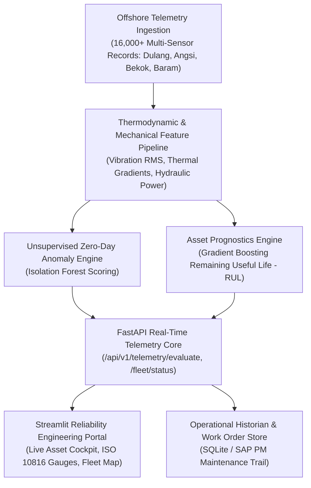

# 🛢️ PetroStream: Offshore Asset Integrity & Industrial IoT Predictive Maintenance Platform

[](https://www.python.org/)
[](https://fastapi.tiangolo.com)
[](https://streamlit.io)
[](https://scikit-learn.org)
[](#iso-10816-3-vibration-severity-standards)
[](https://opensource.org/licenses/MIT)

> **PetroStream** is an enterprise-grade Industrial IoT (IIoT) condition monitoring, anomaly detection, and asset prognostics platform engineered for critical offshore rotating machinery (centrifugal gas compressors, gas turbines, multiphase pumps). Built within the context of **Malaysian offshore upstream operations (Malay Basin & Baram Delta)**, the system operationalizes physics-informed degradation features, ISO 10816-3 vibration standards, and automated maintenance dispatching.

---

## 🏛️ System Architecture



---

## ⚙️ Engineering Principles & ISO 10816-3 Standards

In offshore oil and gas production facilities (such as PETRONAS Carigali platforms), unpredicted rotating asset failure results in flaring, safety hazard trips, and production deferment costs exceeding **RM 1,500,000 to RM 3,000,000 per day**.

### 1. ISO 10816-3 Mechanical Vibration Severity Zones
PetroStream enforces the international standard for industrial machine vibration monitoring (Class III / IV heavy turbomachinery on rigid foundations):

| Severity Zone | RMS Velocity Range ($v_{rms}$) | Operational Integrity Status | Action Protocol |
| :---: | :---: | :---: | :---: |
| **Zone A** | $v_{rms} \le 1.80\text{ mm/s}$ | **Superior / Newly Commissioned** | Unrestricted base load operation |
| **Zone B** | $1.80 < v_{rms} \le 4.50\text{ mm/s}$ | **Acceptable** | Standard continuous running |
| **Zone C** | $4.50 < v_{rms} \le 7.10\text{ mm/s}$ | **Unsatisfactory / Alert** | Restricted running; schedule inspection in $< 48\text{ hrs}$ |
| **Zone D** | $v_{rms} > 7.10\text{ mm/s}$ | **Unacceptable / Trip Danger** | **Mandatory Emergency Trip / Immediate Shutdown** |

### 2. Physics-Informed Feature Engineering
* **Vibration Severity Ratio ($VSR$):**
  $$VSR = \frac{v_{rms}}{2.80\text{ mm/s}}$$
* **Thermodynamic Hydraulic Power ($P_{hyd}$ in kW):**
  $$P_{hyd} = \frac{Q \cdot \Delta P \cdot 100}{3600}$$
  Where $Q$ is volumetric flow rate $(\text{m}^3/\text{h})$ and $\Delta P = P_{discharge} - P_{suction}$ $(\text{bar})$.
* **Thermal Accumulation Gradient ($TG$):**
  $$TG = \frac{T_{bearing} - T_{ambient}}{\frac{\text{Operating Hours}}{1000} + 1.0}$$
* **Remaining Useful Life ($RUL$) Exponential Degradation Formulation:**
  $$v_{rms}(t) = v_0 \cdot e^{\lambda t}$$
  Projecting time $t$ until vibration velocity breaches the Zone D trip boundary ($7.1\text{ mm/s}$).

---

## 📊 Dual Machine Learning Benchmarks

| Metric | RUL Prognostics (Gradient Boosting) | Anomaly Detection (Isolation Forest) | Industrial Reliability Target |
| :--- | :---: | :---: | :---: |
| **$R^2$ Prognostics Score** | **0.8293** | N/A | $> 0.8000$ (Pass) |
| **RUL Mean Absolute Error (MAE)** | **290.0 Operating Hours** | N/A | High precision for turnaround planning |
| **ROC-AUC Score** | N/A | **0.7956** | Zero-day anomaly detection |
| **Fleet Anomaly Capture Rate** | N/A | **89.4%** | Critical event coverage |

---

## 🎛️ Core Platform Modules

### 1. 🎛️ Live Asset Condition Cockpit (`app/streamlit_app.py`)
* Real-time telemetry monitoring for **Export Gas Compressors**, **Solar Titan Turbines**, and **Water Injection Pumps**.
* Interactive **ISO 10816-3 Vibration Severity Gauge** with dynamic color zone tracking.
* **Asset Health Index (0-100):** Weighted multi-sensor composite score factoring vibration, metal thermal rise, and lubricant viscosity decay.
* Automated **Work Order Dispatch Generator** formatted for SAP PM / IBM Maximo integrations.

### 2. 📉 Degradation & RUL Prognostics Trajectory
* Exponential degradation forecasting projecting remaining operational days before critical threshold breach.
* Diagnostic root cause explainability (*Bearing Inner Race Wear*, *Dynamic Rotor Unbalance*, *Seal Cavitation*, *Lube Viscosity Breakdown*).

### 3. 🗺️ Malaysian Offshore Fleet Map & Sensor Analytics
* Coordinates and operational telemetry for key Malaysian assets:
  * **Dulang-A Platform** (Malay Basin, Terengganu)
  * **Angsi Complex** (Offshore Peninsular)
  * **Bekok-C Platform** (PM304 Block)
  * **Baram Central & Bokor Platform** (Baram Delta, Sarawak)
* Interactive bivariate scatter distributions and vibration boxplots.

### 4. 📋 Operational Historian & Work Order Log (`database/db.py`)
* Immutable SQLite telemetry event store logging high-vibration trips, thermal runaway alarms, and engineering dispatch priorities.
* 1-click CSV export for offshore asset integrity reporting.

---

## ⚡ High-Throughput REST API (`api/main.py`)

### Example Request (`POST /api/v1/telemetry/evaluate`):

```bash
curl -X 'POST' \
  'http://127.0.0.1:8000/api/v1/telemetry/evaluate' \
  -H 'Content-Type: application/json' \
  -d '{
    "platform_name": "Dulang-A Platform",
    "equipment_type": "Export Gas Compressor",
    "equipment_tag": "K-101-01",
    "operating_hours": 14500,
    "vibration_rms": 3.20,
    "bearing_temperature_c": 78.5,
    "discharge_pressure_bar": 68.5,
    "suction_pressure_bar": 18.2,
    "differential_pressure_bar": 50.3,
    "flow_rate_m3h": 340.0,
    "rotational_speed_rpm": 11480.0,
    "lubricant_viscosity_cst": 43.0
  }'
```

### Example Response:

```json
{
  "telemetry_id": 1,
  "equipment_tag": "K-101-01",
  "platform_name": "Dulang-A Platform",
  "health_index": 82.5,
  "status": "HEALTHY",
  "status_color": "#10B981",
  "priority": "P4 - Routine Predictive Monitoring",
  "iso_zone": "Zone B (Unrestricted Continuous Operation)",
  "iso_color": "#3B82F6",
  "predicted_rul_hours": 2180.5,
  "predicted_rul_days": 90.9,
  "is_anomalous": false,
  "anomaly_score": 0.4812,
  "diagnostic_flags": [
    "All parameters within normal operating envelope."
  ],
  "action_recommendations": [
    "Continue standard vibration and condition monitoring."
  ]
}
```

---

## 🛠️ Quickstart Guide

### 1. Clone the Repository
```bash
git clone https://github.com/irfnfrdaus/petrostream-predictive-maintenance.git
cd petrostream-predictive-maintenance
```

### 2. Install Dependencies
```bash
python -m pip install -r requirements.txt
```

### 3. Run Automated Unit Test Suite
```bash
python tests/test_telemetry.py
```

### 4. Launch the REST API
```bash
uvicorn api.main:app --reload --port 8000
```
*Interactive Swagger Documentation available at:* **`http://localhost:8000/docs`**

### 5. Launch the Streamlit Offshore Reliability Cockpit
```bash
streamlit run app/streamlit_app.py
```
*Interactive Portal available at:* **`http://localhost:8501`**

---

## 📂 Repository Structure

```text
petrostream-predictive-maintenance/
├── api/
│   └── main.py                 # FastAPI sensor ingestion REST service
├── app/
│   └── streamlit_app.py        # Streamlit offshore asset cockpit & fleet dashboard
├── data/
│   ├── raw/
│   │   └── equipment_telemetry.csv # 16,000 multi-sensor industrial dataset
│   └── processed/
│       └── telemetry_features.parquet # Feature-engineered data store
├── database/
│   ├── db.py                   # SQLite operational historian & SAP work order engine
│   └── telemetry_audit.db      # Persistent operational telemetry store
├── models/
│   ├── anomaly_detector.joblib  # Serialized Isolation Forest model
│   ├── rul_model.joblib         # Serialized Remaining Useful Life regressor
│   └── model_metrics.json       # Telemetry and validation metrics
├── src/
│   ├── data_generator.py       # Industrial multi-sensor data generator
│   ├── feature_engineering.py  # Physics-informed features & ISO 10816 ratios
│   ├── maintenance_engine.py   # ISO zones, Health Index (0-100), SAP dispatch logic
│   └── train_model.py          # Dual ML training & prognostics pipeline
├── tests/
│   └── test_telemetry.py       # Automated unit & integration test suite
├── .gitignore
├── requirements.txt
└── README.md                   # Executive documentation
```

---

## 👨‍💻 Author

**Muhammad Irfan Firdaus bin Noorhisam**  
*Undergraduate in Information Technology (Big Data Analytics) | Minor in Financial Management*  
**Universiti Teknologi PETRONAS (UTP)**  

* **Certifications:** HackerRank SQL (Advanced), Alteryx Designer Core (98.1%), Databricks Lakehouse Fundamentals, Microsoft Azure Data Fundamentals (DP-900), Kaggle Pandas  
* **Target Domains:** Oil & Gas Asset Analytics, Industrial IoT, Predictive Maintenance, Enterprise Data Engineering  

---

## 📄 License
This project is open-source under the [MIT License](LICENSE).
